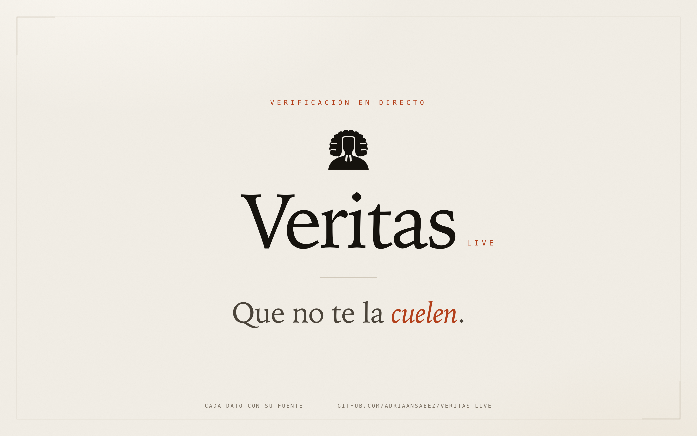
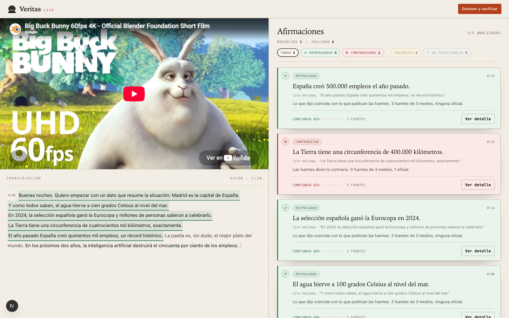

# VerifyLive

**Que no te la cuelen.**

Pon un debate, un mitin, una entrevista o cualquier vídeo donde alguien hable.
VerifyLive lo escucha, separa lo que es una afirmación comprobable de lo que es
ruido, la busca en prensa y en fuentes oficiales, y te enseña en pantalla, en el
momento, si hay algo que la respalde o que la desmienta. Con el enlace, para que
lo mires tú.

No hace falta que te fíes de nadie, ni de nosotros: cada veredicto lleva debajo
las fuentes con las que se tomó.

---

## La idea

En un debate de hora y media se sueltan cifras a un ritmo que nadie puede
comprobar sobre la marcha. Para cuando alguien verifica aquel «hemos
multiplicado por veinte la inversión», el debate terminó hace tres días y el
titular ya lo leyó todo el mundo.

VerifyLive hace esa comprobación mientras la frase todavía está en el aire. No
sustituye a un periodista: le quita de encima el trabajo mecánico de pillar la
afirmación, buscarla y ponerle una fuente al lado.

## Lo que NO hace

Esto es lo que separa una herramienta útil de un juguete que da la razón al que
lo usa.

**No es una máquina de la verdad.** Un detector de mentiras que acierta siempre
no existe, y el que diga tenerlo miente más que el político. VerifyLive no dice
«esto es mentira»: dice «estas tres fuentes contradicen lo que acaba de decir»,
y te las enseña.

**No rellena huecos.** Si no encuentra con qué comprobar algo, lo marca como *no
verificable* y se queda callado. Es la respuesta aburrida, y es la honesta.
Preferimos quedarnos cortos a colar una certeza que no tenemos.

**No confunde una opinión con un dato.** «La sanidad va a peor» no es
comprobable, por mucho que se diga con énfasis. «Hemos invertido 19.000 millones
desde 2026» sí lo es. VerifyLive solo entra al segundo tipo de frase, y lo decide
preguntándole al modelo si dos periodistas con las mismas fuentes delante
llegarían a la misma conclusión.

**No te dice lo que quieres oír.** El veredicto sale de las fuentes, no de quién
habla. Si la afirmación de tu partido está respaldada, lo dirá igual.

## Qué ves en pantalla



Arriba a la izquierda, el vídeo. Debajo, lo que se está diciendo, transcrito en
tu propio ordenador. A la derecha, una ficha por cada afirmación que merece
comprobarse, con uno de estos cinco desenlaces:

| Estado | Qué significa |
|---|---|
| **Respaldada** | Dos medios distintos o más sostienen lo que dijo |
| **Contradicha** | Las fuentes dicen lo contrario |
| **Engañosa** | El dato es cierto, pero falta un contexto que lo cambia todo |
| **No verificable** | No hay con qué comprobarlo, o no era comprobable |
| **Provisional** | Hay indicios, pero no para darlo por zanjado |

**Provisional** es la etiqueta más importante de las cinco. Aparece cuando hay
una sola fuente, cuando ninguna es un medio de referencia, o cuando la frase es
demasiado vaga para resolverse en un sí o un no. Es la manera de no fingir
certeza cuando no la hay.

Un número correcto tampoco hace cierta toda la frase: si las fuentes confirman
la cifra pero no el «récord histórico» que la acompaña, sale **engañosa**. Y una
diferencia del 10 % o más entre lo dicho y lo publicado se corrige sola, sin que
el modelo tenga voz.

## Cómo decide, por dentro

El veredicto no lo escribe un modelo de texto que pueda irse por las ramas. Lo
decide **Clef**, que no redacta: recibe la afirmación con sus fuentes numeradas
y responde con probabilidades a preguntas cerradas.

Son estas cinco:

| Pregunta a Clef | Para qué sirve |
|---|---|
| ¿Qué veredicto justifica **solo** la evidencia aportada? | elige entre respaldada, contradicha, engañosa y no verificable |
| ¿Es un hecho concreto, y no una opinión, una predicción o un juicio de valor? | deja fuera lo opinable |
| ¿Cuánta fuerza y relevancia directa tiene esta evidencia? | de «ninguna» a «primaria y concluyente» |
| ¿Haría falta más o mejor evidencia para verificar esto con responsabilidad? | enciende el aviso de **provisional** |
| ¿Dos periodistas con estas fuentes llegarían a la misma conclusión? | impide zanjar lo que depende de la interpretación |

La instrucción le prohíbe tirar de lo que sabe: solo puede usar las fuentes que
se le entregan. Si no bastan, tiene que decirlo.

**Y Clef tampoco tiene la última palabra.** Por encima hay una política que
rebaja el resultado cuando las fuentes no dan para tanto: menos de dos medios
distintos, ninguna fuente de referencia, o una frase sin una sola cifra, fecha o
nombre propio a la que agarrarse. El modelo propone; las reglas deciden qué se
puede afirmar.

Técnicamente: `POST /v1/systemone` con `model: "clef"`, en una cola de una
petición en vuelo, con reintentos en `429`, `502` y `504` y timeout de 50 s.

## Flujo completo

```text
▶️ enlace de YouTube ───┐
🎙️ micrófono / pestaña ─┤
                        ├─▶ Parakeet TDT 0.6B v3 (WebGPU, en el navegador)
📼 fixture 90 s ────────┘        │  ventanas de 3–10 s que cierran en pausa
                                 ▼
                    POST /api/sessions/[id]/segments
                                 │
                                 ▼
      ClaimWindow: hasta 6 fragmentos ASR → tramos exactos de lo dicho
                                 │
                                 ▼
      Clef · gate de 2 preguntas:  closed ≥ 0.5  ·  factual ≥ 0.6
                    ├─ no cierra / no es factual ──▶ se muestra, no se verifica
                    └─ aprobado
                                 ▼
      Canonicalizador (chat NaN opcional / heurística local)
      → hechos atómicos + consultas + cita literal
                                 ▼
      Evidencia: Wikipedia + SearXNG (o Bing/Google/Brave) + Jina
      → guard SSRF → sanitización → rerank ≥ 0.3 → dedupe por medio
                                 ▼
      Clef · verdict + is_checkable + evidence_quality + needs_more_sources
                                 ▼
      Política determinista: ≥ 2 medios y confianza ≥ 0.65,
      verificación numérica (≥ 10 % ⇒ contradicha),
      superlativo sin respaldo ⇒ engañosa, techos de confianza
                                 ▼
      SQLite (claims · evidence · revisions) ──▶ SSE ──▶ timeline + fuentes
```

Detalle etapa por etapa, con entradas, salidas y archivos: **[docs/flujo.md](docs/flujo.md)**.

## Decisiones de ingeniería que sostienen la demo

- **Transcripción local, no en la nube.** Parakeet corre en WebGPU; el audio
  nunca se sube. Pesos (~1,26 GB) descargados una vez y cacheados en OPFS.
- **Ventanas ASR no son frases.** El servidor ofrece a Clef tramos exactos de lo
  dicho, nunca texto generado o reescrito.
- **Gate de dos preguntas.** Una sola pregunta puntuaba un fragmento truncado
  (0,56) por encima de la frase completa que lo contenía (0,23). Con `closed`
  + `factual`, ese fragmento baja a 0,02 y el tramo completo sube a 0,88. Los
  umbrales se calibraron sobre capturas reales.
- **Buscador medido, no elegido por intuición.** SearXNG autoalojado encontró
  fuente relevante para 8/8 afirmaciones en español (relevancia media 0,93),
  frente a 6/8 y 0,66 del RSS sin clave. Sin SearXNG, la app sigue funcionando
  con Bing Noticias y cero configuración.
- **Rerank con umbral.** Por debajo de 0,3 la fuente se descarta: «Historia del
  ferrocarril en España» puntuaba 0,198 para una afirmación sobre alta velocidad
  y antes se presentaba como evidencia.
- **Trazabilidad.** Cada veredicto guarda conectores, latencias, consultas,
  fuentes descartadas y probabilidades del gate. Una lista vacía de fuentes ya
  no se parece a un buscador caído.
- **El vídeo suena donde se captura.** El audio de un iframe de otro origen no
  se puede leer desde la página, así que el reproductor va incrustado y se
  captura esta misma pestaña: el audio sigue sin salir del equipo. Eso obligó a
  bajar COEP de `require-corp` a `credentialless` (ambos aíslan el origen, pero
  el primero exige una cabecera que YouTube no manda) y a pedir la captura con
  `preferCurrentTab`, porque con el selector completo es fácil compartir la
  pestaña equivocada y entonces no llega ni un sonido.
- **Dos evaluadores, no uno.** Clef y Jev (TypeSafe) hablan el mismo
  protocolo (`/v1/systemone`, preguntas `noul`/`choice`/`score`), así que la
  app pregunta al primero que siga en pie y solo recurre al clasificador
  local si no queda ninguno. No es teoría: NaN retiró el modelo «clef» y la
  app, que entonces no sabía distinguir «el evaluador ha muerto» de «aquí no
  hay nada que comprobar», se quedó transcribiendo sin sacar una sola ficha.
  Los umbrales se fijan por modelo, porque no son transferibles: con el 0,65
  calibrado para Clef, Jev marcaba como dudoso hasta un dato de Eurostat con
  fuente oficial.
- **Correcciones sin borrar historia.** Cada evaluación queda como revisión
  numerada con confianza, calidad de evidencia y si fue provisional o simulada.

## Estructura del repositorio

```text
apps/web/                 La aplicación (Next.js 16 + React 19 + TypeScript)
  app/api/                Rutas HTTP y SSE
  components/             Vídeo, timeline, tarjeta de claim, cajón de evidencia
  lib/
    claims/               Ventana ASR, gate Clef, canonicalizador, anclas
    evidence/             Wikipedia, SearXNG, buscadores, Jina, rerank, SSRF
    clef/                 Cliente, parser y cola 1-a-1 con reintentos
    verdict/              Política, verificación numérica, superlativos
    db/                   node:sqlite + repositorio
    orchestrator/         Une transcripción → claim → evidencia → veredicto
  fixtures/               Discurso demo y corpus curado de evidencia
  docs/demo-script.md     Guion de demo de 3 minutos
  search/                 SearXNG autoalojado (docker-compose)
  scripts/probe-nan.ts    Diagnóstico de una llamada real a NaN/Clef
docs/                     Referencia de la API de Clef y este flujo
examples/                 Llamadas de ejemplo a Clef (curl, Python, Node)
spikes/parakeet-browser/  Spike que valida Parakeet en WebGPU
```

## Arranque rápido

Desde la raíz del repositorio, un solo comando:

```bash
npm start
```

Comprueba la versión de Node, instala lo que falte, crea el `.env.local`,
levanta el buscador si encuentra Docker, busca un puerto libre y arranca.
Lo que no puede resolver te lo dice antes de empezar, no a mitad.

Necesitas **Node ≥ 22** (la app usa `node:sqlite`) y **Chrome o Edge**: la
transcripción corre en WebGPU y la captura usa `getDisplayMedia`, así que el
navegador no es opcional. La primera captura descarga el modelo de voz
(~1,3 GB) y lo deja en caché.

A mano, si lo prefieres:

```bash
cd apps/web
npm install
cp env.example .env.local
npm run dev                 # http://localhost:3000
```

Sin `.env.local` la app arranca en **modo simulado** y funciona completa con el
fixture y el corpus local. Para activar un evaluador real:

```bash
# en apps/web/.env.local
# Basta con uno. Con los dos, se usa el primero que responda.
NAN_KEY=tu-key-de-nan            # Clef
TYPESAFE_API_KEY=tu-key          # Jev, en console.typesafe.ai

# opcional: buscador autoalojado (mejor evidencia sin claves)
npm run search:up
VERIFYLIVE_SEARXNG_URL=http://localhost:8099
```

La app necesita COOP/COEP para WebGPU y `SharedArrayBuffer`; `next.config.ts`
las añade, con COEP en `credentialless` para que el reproductor incrustado
cargue sin perder el aislamiento de origen. Si la sirves detrás de otro proxy,
replícalas tal cual.

## Desplegarlo en NaN Cloud

Hay un `Dockerfile` en la raíz, que es lo que pide la plataforma. En
cloud.nan.builders creas un Space, conectas el repositorio y marcas **Expose
over HTTP** en el **puerto 3000**.

Tres ajustes que no son opcionales:

| Ajuste | Valor | Por qué |
|---|---|---|
| **Réplicas** | **1** | La cola del evaluador y el bus de eventos viven en el proceso. Con dos réplicas, el navegador se conecta a una y las fichas se generan en la otra: la pantalla se queda vacía. |
| **Almacenamiento** | un volumen en `/data` | La base de datos vive ahí. Sin volumen, cada despliegue borra las sesiones. |
| **Variables** | `NAN_KEY` o `TYPESAFE_API_KEY` | Sin ninguna arranca en modo simulado y lo etiqueta como tal. |

El buscador autoalojado no viaja en esta imagen. Sin él la app usa el
buscador sin clave, que encuentra menos fuentes relevantes; si quieres
SearXNG, despliégalo como una segunda app del Space y apunta
`VERIFYLIVE_SEARXNG_URL` a su dirección interna.

Las cabeceras COOP/COEP las pone Next en cada respuesta, así que no hace
falta configurarlas en la plataforma. Y recuerda que quien lo use necesita
Chrome o Edge: la transcripción corre en su navegador, no en el servidor.

## Cómo usarlo

Abre http://localhost:3000 y elige por dónde entra el audio:

| Opción | Para qué sirve |
|---|---|
| **Pegar un enlace de YouTube** | Un debate, un mitin, una entrevista. El vídeo se abre dentro de la app, junto a la transcripción y las fichas. |
| **Compartir el audio de una pestaña** | Cualquier otra cosa que suene en el navegador: un directo, una radio, una videollamada. |
| **Usar el micrófono** | Lo que se oiga en la sala. |
| **Ver demo guionizada (90 s)** | Un discurso de ejemplo con su corpus, sin micrófono y sin red. |

Con un enlace de YouTube, el vídeo se reproduce en la propia pestaña y Chrome
pide permiso para compartirla con el audio marcado. Acéptalo: es así como el
sonido llega al transcriptor **sin salir de tu ordenador**. Carga primero el
vídeo, sitúalo donde te interese y pulsa entonces «Empezar a verificar».

Mires lo que mires, verás los cinco desenlaces: respaldada, contradicha,
engañosa, no verificable y provisional.

Guion completo de 3 minutos: **[apps/web/docs/demo-script.md](apps/web/docs/demo-script.md)**.

## Verificación

```bash
cd apps/web
npm run check      # tsc --noEmit + Vitest
npm run probe:nan  # llama al endpoint real con el mismo contrato; sin NAN_KEY no llama
```

Estado actual: **171 tests pasan, 3 se saltan** (los bancos de regresión con
captura real, que requieren red y `NAN_KEY`). Los replay tests se ejecutan
explícitamente:

```bash
VERIFYLIVE_REPLAY=1 npx vitest run scripts/replay-detection.test.ts --disable-console-intercept
VERIFYLIVE_REPLAY=1 npx vitest run scripts/replay-evidence.test.ts --disable-console-intercept
```

El primer banco vuelve a pasar 56 segmentos reales de Parakeet por la ventana y
el gate; el segundo lleva las afirmaciones por canonicalizador, conectores y
política. Sobre esa captura, la detección pasó de 3 afirmaciones (una cortada a
mitad de frase) a ~20, incluyendo las 6 afirmaciones contrastables de referencia.

## Hasta dónde llega, y hasta dónde no

Conviene saberlo antes de confiar en ninguna pantalla:

- **Un veredicto vale lo que valgan sus fuentes.** Si el tema es muy reciente o
  muy de nicho, no habrá con qué comprobarlo y saldrá *no verificable*. No es un
  fallo: es el sistema negándose a inventar.
- **El oído no es perfecto.** La transcripción se equivoca con nombres propios y
  con cifras grandes dichas de corrido. Por eso cada ficha guarda la cita
  literal: puedes ver qué se oyó exactamente.
- **Va con retraso, aunque sea en directo.** Entre que se dice una frase y
  aparece su ficha pasan unos segundos. Es el tiempo de oír, buscar y comprobar.
- **Solo español**, de momento. El transcriptor y las preguntas están ajustados
  a este idioma.
- **Es un prototipo.** Base de datos local, un solo proceso, cuotas en
  memoria. Vale para una demo o para ti; no para abrirlo a medio país.
- **Sin internet** sigue funcionando con el discurso de ejemplo y su corpus,
  pero casi nada recibe fuentes nuevas.

## Documentación

| Documento | Contenido |
|---|---|
| [docs/flujo.md](docs/flujo.md) | Flujo completo, etapa por etapa, con código y rutas de fallo |
| [apps/web/README.md](apps/web/README.md) | Decisiones técnicas detalladas, mediciones y problemas habituales |
| [docs/api.md](docs/api.md) | Referencia de Clef en NaN: petición, tipos, límites y errores |
| [apps/web/docs/demo-script.md](apps/web/docs/demo-script.md) | Guion de demo en vivo (3 minutos) |

## Créditos

- **Clef** — modelo de decisión de Cloudflare (Apache 2.0), servido por NaN.
- **Parakeet TDT 0.6B v3** — NVIDIA, ejecutado en el navegador con `browser-whisper`.
- **Next.js**, **React**, **SQLite (`node:sqlite`)** y **SearXNG**.
- Corpus y discurso de demo: ficticios, creados para el MVP.

---

<p align="center">
  <a href="https://nan.builders/?ref=built-with-nan">
    
  </a>
</p>
