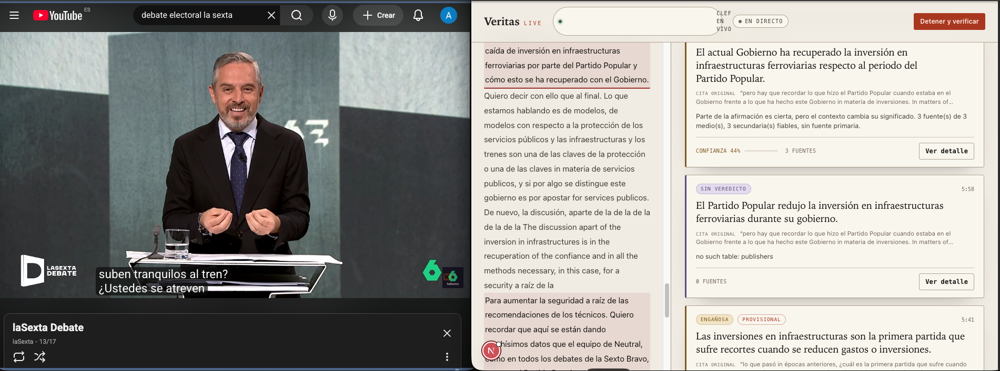

# #2 NaN Hackathon — Decide con Clef

Documentación oficial para participantes del **#2 Hackathon de NaN**: cómo llamar a **Clef** desde NaN y la especificación de cada reto.

> El entregable de este repositorio ([Veritas Live](../README.md)) implementa el **Reto 3: fact-check**. Este documento se conserva como referencia de la API y de las bases del hackathon.

- **Cuándo:** del viernes 13 de noviembre de 2026 a las 17:00 al domingo 15 a las 17:00 (hora peninsular).
- **Dónde:** en el Discord de la comunidad NaN.
- **Equipos:** de 3 personas como máximo. Se forman automáticamente; si quieres ir con tus amigos, escríbenos por Discord una vez apuntado.
- **Premio:** suscripción de 200 € durante un mes en NaN.
- **Objetivo:** crear una app en la que **Clef tome la decisión**.

## ¿Qué es Clef?

Clef es un **modelo de decisión** de Cloudflare (pesos abiertos, Apache 2.0). No escribe texto. Le das un **estado** (la situación) y una o varias **preguntas tipadas**, y te devuelve una probabilidad para cada respuesta permitida.

| Tipo | Para qué sirve | `criteria` |
|---|---|---|
| `noul` | Sí o no | — |
| `choice` | Elegir una opción entre las que tú defines | Diccionario `id: descripción` |
| `score` | Puntuar en una escala ordenada | Lista ordenada de niveles |

Sirve para tomar decisiones rápidas y baratas: enrutar, filtrar, clasificar o dar permisos. Para generar texto, combínalo con los modelos de chat de NaN.

## Empieza en 1 minuto

```bash
export NAN_KEY="tu-key-de-nan"

curl -s https://api.nan.builders/v1/systemone \
  -H "Authorization: Bearer $NAN_KEY" \
  -H "Content-Type: application/json" \
  -d '{
    "model": "clef",
    "state": "Subject: Checkout broken. Since 10:00 every payment returns Error 502. Our store is losing sales.",
    "questions": {
      "urgent":   { "type": "noul",   "instructions": "Is this support request urgent?" },
      "team":     { "type": "choice", "instructions": "Which team should handle this request?",
                    "criteria": { "billing": "Payments and refunds", "technical": "Outages and errors", "sales": "Plans and upgrades" } },
      "severity": { "type": "score",  "instructions": "How severe is the customer impact?",
                    "criteria": ["No impact", "Minor", "Major", "Critical"] }
    }
  }'
```

> Copia los comandos de este repo, no de capturas o mensajes de chat: las comillas tipográficas (`“ ”`, `‘ ’`) rompen el JSON.

## Documentación

| Documento | Contenido |
|---|---|
| [api.md](api.md) | Referencia del endpoint de Clef en NaN: petición, tipos de pregunta, límites, errores y buenas prácticas |
| [retos/01-enrutador-de-modelos.md](retos/01-enrutador-de-modelos.md) | Reto 1: Clef elige qué modelo de NaN responde cada petición |
| [retos/02-guardarrailes-para-agentes.md](retos/02-guardarrailes-para-agentes.md) | Reto 2: Clef decide si un agente puede ejecutar una acción |
| [retos/03-fact-check.md](retos/03-fact-check.md) | Reto 3: una app que dice si una afirmación es verdadera o falsa |
| [retos/04-tema-libre.md](retos/04-tema-libre.md) | Reto 4: cualquier otra app en la que Clef decida |
| [../examples/](../examples/) | Ejemplos listos para ejecutar en curl, Python y Node.js |

## Ayuda

Pregunta en el Discord de NaN, en el canal del hackathon.

## Exploración de ideas

La comparación, recomendación y planes de desarrollo están en [`../ideas/`](../ideas/README.md):

- [`ClefRoute`](../ideas/01-clef-route/README.md): routing de modelos, privacidad y ahorro visible.
- [`Veritas Live`](../ideas/02-veritas-live/README.md): fact-check visual de discursos con fuentes.
- [`Radar de precios`](../ideas/03-radar-precios/README.md): comparador de valor ajustado a las preferencias del usuario.
